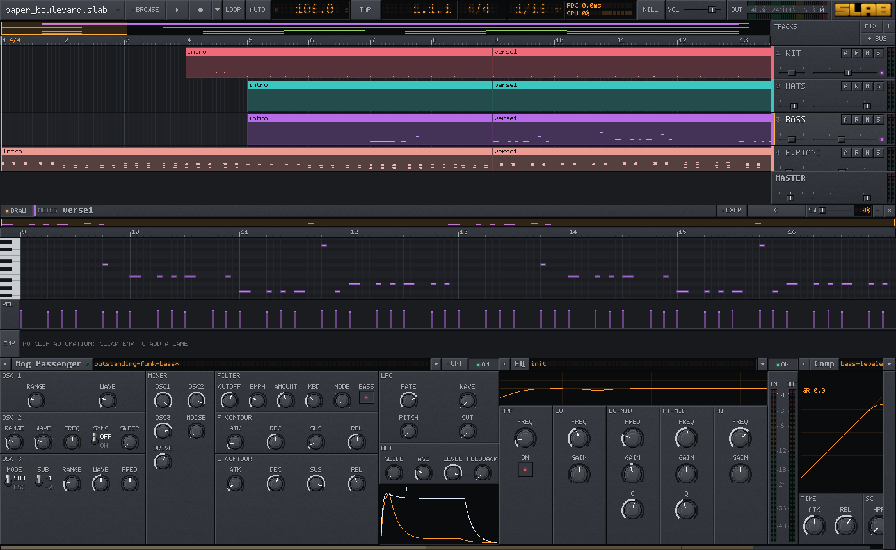
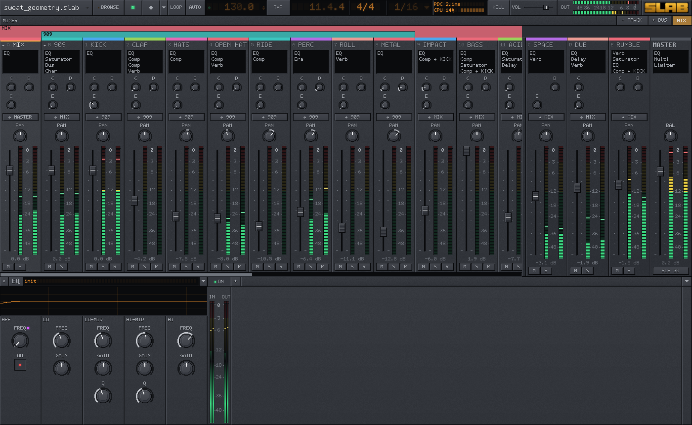

# Slab

> 💬 Come talk about Slab in `#slab` on [The Fixpoint](https://discord.gg/Ky535CQ9pj) Discord.

**A free music studio for Apple Silicon Macs, where every instrument and
effect is a short file you can open and change.**



Slab (the Slab Audio Workstation) is a complete place to make music: lay
out a song, write parts in the piano roll or record them, play twenty
instruments through twenty-eight effects, automate anything, and mix it
down to a WAV, FLAC or MP3. It looks like a rack of 2000s studio hardware
and runs like native code, because it is.

## What you get

### Twenty instruments

Each is modeled on the instrument it's named after, or built from the
physics of one.

- **Analog and virtual-analog synths**
  - **Mog Passenger**, after the Moog Prodigy and Messenger: three
    oscillators into a driven transistor ladder
  - **SM-24 Mono**, after the Korg MS-20: its two screaming filters and
    a patch panel
  - **Squelch 33**, after the Roland TB-303: an acid bassline synth
  - **Profit-5**, after the Sequential Prophet-5, with POLY-MOD
  - **Ju-Know**, after the Roland Juno: a DCO polysynth with its chorus
  - **Juniper-8**, after the Roland Jupiter-8: two VCOs with cross mod
    and sync into a 24/12 dB filter
  - **C-Beam 80**, after the Yamaha CS-80: two voices a note, poly
    aftertouch, and every factory preset
  - **Ambika**, after Mutable Instruments' six-voice polysynth
- **Digital synths**
  - **FM-7.11**, after the Yamaha DX7: six operators and 32 algorithms;
    it opens your own `.syx` cartridges
  - **Concoction**, a wavetable synth that reads Serum tables, with a
    wavetable editor
  - **Unfairlight TMI**, after the Fairlight CMI: any sample becomes
    8-bit voice RAM, grit included
- **Physical models**
  - **Hammerwork Grand**, a piano of felt hammers on modal strings
  - **Rhodes E-Piano**, tines and a pickup fitted to a sampled Mark I
  - **Tonewheel Organ**, 91 wheels, nine drawbars, percussion, scanner
    vibrato and key click
  - **Fretwire** bass and **Fretwire Guitar**: waveguide strings with
    pickups and bodies, played with fingers, a pick, slap or pop, with
    bends, slides, hammer-ons and finger vibrato
  - **Skinwork Kit**, a drum kit of struck membranes and coupled
    cymbal plates
  - **Magnet Zither**, ten strings plucked from the keys or set
    droning by two spinning magnet discs
- **Drums and samples**
  - **DS-404**, an 808/909-style drum machine
  - **Sampler**, for WAV, FLAC, AIFF, SFZ and folder kits

### Twenty-eight effects

- **EQ and dynamics:** EQ, GEQ (eight bands with a spectrum display),
  Comp, Bus compressor, Multi (multiband, up to OTT), Char (FET, opto,
  vari-mu and SMUSH), Gate and Limiter.
- **Color and drive:** Saturator, Tape (cassette and VHS), Era (sampler
  converters from the SP-1200 to the MPC60), Funk Overload, Grinder,
  Folder, Octaver, and Ampstack, an amp and cabinet for bass and guitar.
- **Movement and space:** Chorus, Phaser, Wobble, Rotary Speaker,
  Delay, Tape Echo, Verb (plate, room and hall) and CONVO, a
  convolution reverb that takes any WAV as its space.
- **Stranger things:** Buffer Loom (grains and repeats from live
  input), Modal Bank (a tuned resonator), Sideband (frequency shifter
  and ring modulator) and Magnet Zither FX (the zither's strings,
  driven by your audio).

Any chain of these can go into a **Rack** or **FX Rack**: lanes in
parallel, eight macro knobs, and rigs saved as presets.

### A studio around them

- **Arrange.** Up to 32 tracks, including buses. Clips and folding
  groups, sections and locators, tempo changes and ramps, meters, groove
  and swing, polymeter and polytempo per track, a metronome.
- **Write notes.** A piano roll with velocity and per-note pitch,
  pressure and slide, scale marks, octave echoes and readable drum lanes;
  one set of editing gestures across every editor.
- **Play.** MIDI keyboards and pads, with LEARN for knobs; the computer
  keyboard as a piano, a grid of fourths or chords; an arpeggiator on
  any instrument; unison on any synth.
- **Record and edit audio.** Record from any input, mono or stereo.
  Warp clips with five stretch modes, find hits and tempos, quantize a
  take, let the song follow a live drummer, slice a loop to a sampler,
  and put a voice in key with Tune, which can also move its formants.
- **Turn audio into music.** Hum or sing into notes, hear a clip's
  chords, turn a drum loop into a kit part, and split a song into stems
  (the stem model is a download).
- **Mix.** Automation lanes you can draw or record, sends, sidechain
  keys, groups, delay compensation, and a loudness stage for the master.
- **Finish.** Bounce a selection, freeze a track, and export the mix,
  stems or sections to WAV, AIFF, FLAC, ALAC, AAC or MP3 with dither
  and a loudness report.
- **Don't lose work.** Autosave and crash recovery, fast undo, logs, and
  an update check against GitHub releases.

### Sounds, quality, and code you can open

- **Sounds that are yours to use.** Factory presets for nearly every machine,
  an FM bank designed from scratch, a sampled-voice bank for the
  Unfairlight, and sampled instruments: grand and upright pianos,
  harpsichord, an FM piano, marimba, kalimba and ocarina; violin, viola
  and cello sections, pizzicato contrabass, trumpet and trombone; two
  electric basses, an electric guitar and an alto sax; and three drum
  kits. All CC0: use them in any music, no credit owed.
- **More sounds when you want them.** Download the Versilian Community
  Sample Library (6 GB), the Versilian Chamber Orchestra, Karoryfer's
  instruments or classic drum machine packs from inside the app, all
  free, or bring your own Fairlight disks.
- **Sound quality first.** 64-bit audio from oscillator to master,
  filters oversampled where they distort, and renders that come out
  bit-identical however many cores they use.
- **Light on your Mac.** Concoction plays eight voices with everything
  switched on for 3.4% of one M1 Pro core.
- **Change anything.** Every instrument and effect is a text file in
  Slab's own language, fy. Open one, change the filter, save, and the
  next copy you load has the new filter, without restarting Slab and
  without a plugin SDK. Put your own machines in
  `~/Music/Slab/Machines` and they appear beside the factory ones.
  Changing a machine while it plays is on the way.



## Get it

Slab is in beta. It needs a Mac with Apple Silicon (M1 or later) and
macOS 13 or later.

```bash
brew install --cask nooga/tap/slab
```

Or, without Homebrew:

```bash
curl -fsSL https://github.com/nooga/slab/releases/latest/download/install.sh | bash
```

Or download the DMG from the
[latest release](https://github.com/nooga/slab/releases/latest) and
drag Slab to Applications. Slab isn't notarized yet, so the first time
you open the DMG version, allow it under System Settings > Privacy &
Security > Open Anyway. The two commands above don't need that step.

## Compose a song

Follow the [composing walkthrough](docs/33-composing.md) for an editable
sketch with jazzy chords, an arp, GEQ, shared delay and a mix/stem export.
The [production guide](docs/21-production-guide.md) covers arrangement and
mixing, and the [slabkit cheat sheet](tools/slabkit/README.md) lists the
Python helpers. See the [production wishlist](docs/34-production-wishlist.md)
for proposed workflow improvements and how to evaluate them.

## Under the hood

Slab is two programs in one. A host written in [Zig](https://ziglang.org)
owns everything that has to be solid: audio I/O, the transport and
clock, the arrangement and piano roll, the mixer and routing, the UI,
projects and undo. Everything that makes sound is a **machine** written
in [fy](fy/), a small concatenative language that lives in this repo.

- **fy compiles to native code as it loads.** A machine's audio path is
  written as `dsp:` words, which fy compiles straight to ARM64, with
  NEON for paired voices and stereo effects. There's no interpreter on
  the audio path and no garbage collector.
- **Code replacements are prepared before publication.** fy supports word
  trampolines, but Slab's raw DSP callers embed compiled bodies and
  addresses. Active definitions stay sealed; new machine instances get
  prepared code. Preserving playing DSP state across source edits remains
  planned ([docs/09-hot-reload.md](docs/09-hot-reload.md)).
- **Audio uses prepared storage and owned versions.** UI prepares controls,
  assets and machine configurations; audio adopts complete versions without
  waiting on UI/compiler locks. UI frees replaced resources after audio
  acknowledges adoption. Parallel callbacks still join admitted realtime
  workers before finishing; admission failure selects serial playback. See
  [the safety contracts and regression evidence](docs/37-realtime-safety.md).
- **A machine is a declaration over kernels.** Its file lists
  parameters, panel layout and presets on top of shared kernels:
  oscillators, filters, envelopes, oversamplers. A panel is laid out
  declaratively and drawn by the host in the 1px-bevel house style.
- **Tracks render in parallel, deterministically.** Each track renders
  on a worker pool, and buses are summed in a fixed order, so a render
  is bit-identical at any thread count. A headless bench renders every
  machine against golden hashes on every change.
- **Songs can be code too.** `tools/slabkit` is a Python library for
  writing songs as scripts, rendered offline with `slab --render`. The
  demos in `songs/` are made that way.

### Build from source

You need [Zig](https://ziglang.org) 0.17 and raylib
(`brew install raylib lame`).

```bash
zig build run     # build and run Slab
zig build test    # the unit tests
zig build bench -- machines/fm86   # render a machine headless, with a report
```

`tools/package_app.sh` builds `Slab.app` (and `--dmg`, `--zip`);
`tools/release.sh` publishes a release and updates the Homebrew cask.

To go deeper, start with [docs/README.md](docs/README.md): the design
docs are the plan, and code follows them. The fy language for machines
is in [docs/18-fy-dsp-language.md](docs/18-fy-dsp-language.md), and
writing a machine in [docs/02-machines.md](docs/02-machines.md).

## Contributing

Pull requests are welcome. Read [CONTRIBUTING.md](CONTRIBUTING.md)
first; the CLA bot asks you to sign the
[Contributor License Agreement](CLA.md) on your first one.

## License

Slab is free software: [GPL-3.0-or-later](LICENSE), with the Slab Machine
Exception, which lets people share the machines, presets, projects and
packs they make under terms of their choice. Factory presets, sounds and
demos are [CC0](LICENSES/CC0-1.0.txt). The name "Slab", the wordmark and
the icon are not licensed; a fork needs its own.
[COPYING.md](COPYING.md) has the details and [NOTICE](NOTICE) the
third-party credits.
